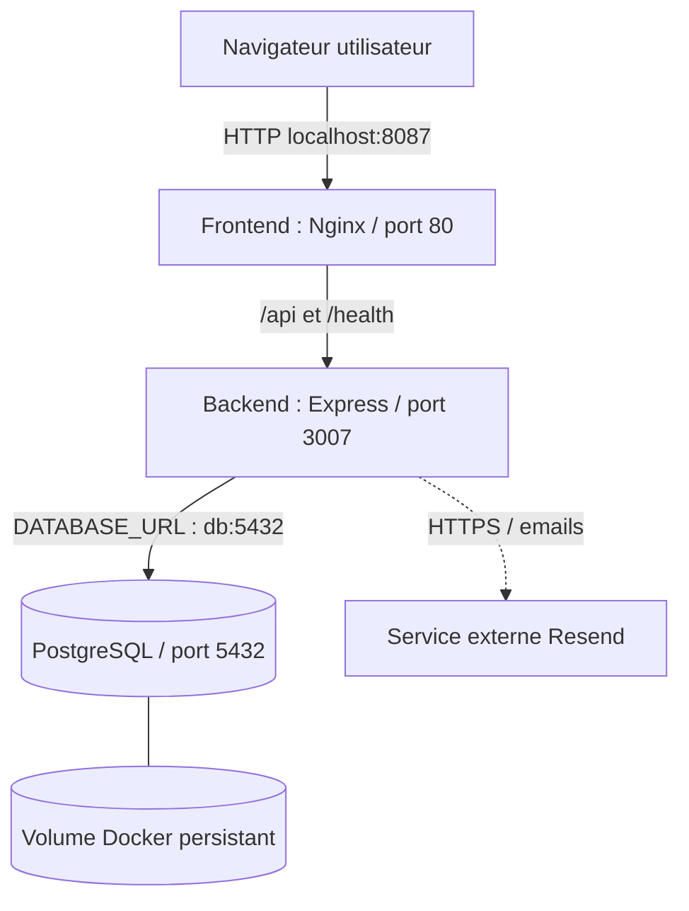

# J1 — Architecture locale de Quiz App

## 1. Présentation

L'application Quiz App sera conteneurisée avec Docker et
orchestrée avec Docker Compose.

Elle comprend trois services :
- frontend : Nginx servant les fichiers générés par Vite
- backend : API Node.js / Express
- db : base de données PostgreSQL

## 2. Schéma d'architecture

## 3. Choix techniques

### Frontend
Le frontend est développé avec Vite.
La commande `npm run build` produit les fichiers statiques.
Nginx servira ces fichiers et transmettra les requêtes API
au backend.

### Backend
L'API Express fonctionne sur le port 3007.
Elle gère les utilisateurs, les résultats des quiz
et l'administration.

### PostgreSQL
La base de données utilise le port interne 5432.
Le fichier `database/init.sql` contient le schéma SQL.
Un volume Docker permettra de conserver les données
après la recréation des conteneurs.

### Réseau
Docker Compose permettra aux services de communiquer
grâce à leurs noms : frontend, backend et db.
Seul le frontend sera exposé au navigateur.

### Sécurité
Les identifiants, mots de passe et secrets seront
fournis par des variables d'environnement.
Le fichier `.env` ne sera pas versionné dans Git.

## 4. Vérifications prévues

- Construction des images Docker
- Démarrage des trois services avec Docker Compose
- Affichage du frontend
- Vérification de la route `/health`
- Création d'un utilisateur
- Enregistrement d'un résultat de quiz
- Vérification de la persistance après recréation
  des conteneurs sans suppression des volumes
